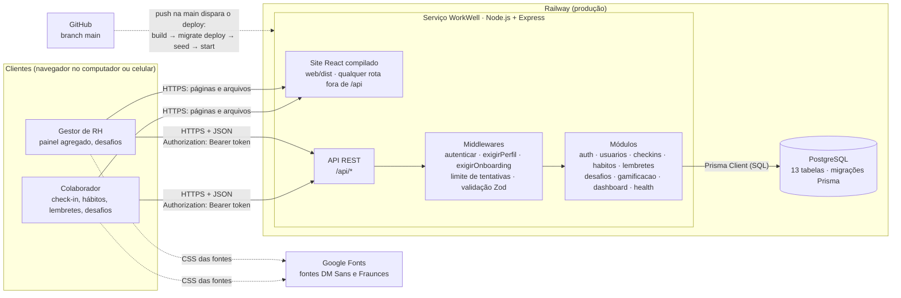

# WorkWell

Protótipo acadêmico de uma plataforma web de bem-estar corporativo. Há dois perfis:

- **Colaborador**: faz o check-in diário, cuida dos seus hábitos, participa de desafios e acumula pontos e medalhas. Os dados individuais pertencem a ele.
- **Gestor de RH**: vê **somente** indicadores agregados e anônimos e cria desafios para a empresa.

Documentação técnica:

- [docs/ARQUITETURA.md](docs/ARQUITETURA.md): como o código está organizado e por quê.
- [docs/API.md](docs/API.md): todas as rotas da API, com quem pode usar cada uma.
- [docs/MAPA_DO_CODIGO.md](docs/MAPA_DO_CODIGO.md): onde está cada funcionalidade e como foi feita.
- [docs/PERGUNTAS_SOBRE_O_CODIGO.md](docs/PERGUNTAS_SOBRE_O_CODIGO.md): perguntas prováveis sobre as partes críticas, com o arquivo, o trecho e o motivo, em linguagem simples.

## Stack

- **TypeScript** no frontend e no backend: uma linguagem só, com tipos que ajudam a revisar e explicar o código.
- **React + Vite**: interface web responsiva.
- **Node.js + Express**: API REST e regras de negócio.
- **PostgreSQL + Prisma**: banco relacional, migrações e acesso tipado.
- **Zod**: validação dos dados que chegam à API.

## Arquitetura

Em produção, tudo roda em **um único serviço Node.js** no Railway: ele entrega o site React já compilado e responde à API no mesmo endereço. O único serviço de apoio (*backing service*) é o **PostgreSQL**, acessado pelo Prisma. Os clientes são navegadores, no computador ou no celular, usados por dois perfis.



Como uma requisição percorre o sistema:

1. O navegador baixa o site (HTML, JS e CSS) do próprio serviço. Só as fontes vêm de fora, do Google Fonts.
2. No login, a API devolve um **token assinado** (vale 8 horas), que o site guarda no `localStorage` e envia no cabeçalho `Authorization` de cada chamada.
3. Os middlewares identificam o usuário pelo token, conferem o perfil (colaborador ou RH) e o onboarding, e o Zod valida os dados de entrada.
4. O módulo da rota aplica a regra de negócio e lê ou grava no PostgreSQL pelo Prisma. O painel do RH só devolve números de grupos com 5 ou mais pessoas.
5. Os lembretes não usam push: com o site aberto, a página consulta `/api/lembretes/pendentes` a cada 30 segundos.

Em **desenvolvimento** são dois processos: o Vite serve o site em `http://localhost:5173` e repassa as chamadas `/api` para a API em `http://localhost:3333`, que usa o PostgreSQL local. Detalhes do código em [docs/ARQUITETURA.md](docs/ARQUITETURA.md).

## Pré-requisitos

- Node.js 24 LTS e npm.
- PostgreSQL 18.
- VS Code com as extensões recomendadas pelo projeto.

Neste computador, o PowerShell bloqueia o atalho `npm.ps1`; por isso os exemplos usam `npm.cmd`. No Prompt de Comando, `npm` também funciona.

## Executar localmente

1. Copie `api/.env.example` para `api/.env` e preencha a `DATABASE_URL`.
2. Abra dois terminais.

Terminal da API (cria o banco, aplica as migrações e carrega os dados fictícios):

```powershell
cd api
npm.cmd install
npm.cmd run db:setup
npm.cmd run dev
```

Terminal da interface:

```powershell
cd web
npm.cmd install
npm.cmd run dev
```

Abra `http://localhost:5173`. A API fica em `http://localhost:3333/api`.

### Contas de demonstração

Todas usam a senha `12345678` (dados fictícios, só para desenvolvimento).

| Perfil | E-mail | Observação |
|---|---|---|
| Colaboradora | `user@ifsp.com` | começa com o check-in de hoje pendente |
| Gestora de RH | `rh@ifsp.com` | painel agregado e desafios |
| Outros colaboradores | `bruno.lima@`, `camila.rocha@`, ... `@workwell.local` | 10 no total; 6 no setor Tecnologia |

Para testar o **onboarding**, use "Criar conta" na tela de login.

Antes de gravar uma demonstração, restaure os dados:

```powershell
cd api
npm.cmd run demo:reset
```

## Hospedagem no Railway

O projeto já está pronto para o Railway: a API também entrega o site, então tudo fica em **um único serviço + um banco PostgreSQL**, num endereço só.

Arquivos envolvidos: `railway.json` (como compilar e iniciar), `package.json` na raiz (scripts `build` e `start`) e `api/src/app.ts` (serve a pasta `web/dist`).

A cada inicialização, o servidor aplica as migrações (`prisma migrate deploy`), roda a carga de dados fictícios (o seed pode ser repetido sem duplicar nada) e sobe a API.

### Passo a passo

1. No [railway.com](https://railway.com), entre com a conta do GitHub dona do repositório.
2. **New Project → Deploy from GitHub repo** → escolha `Workwell`. Em **Settings → Source**, confira a branch (`main` depois do merge do PR).
3. No mesmo projeto: **+ Create → Database → PostgreSQL**.
4. No serviço do WorkWell, aba **Variables**, crie:
   | Variável | Valor |
   |---|---|
   | `DATABASE_URL` | `${{Postgres.DATABASE_URL}}` (referência ao banco criado no passo 3) |
   | `NODE_ENV` | `production` |
   | `TOKEN_SECRET` | um segredo longo. Gere com: `node -e "console.log(require('crypto').randomBytes(32).toString('hex'))"` |
5. Aba **Settings → Networking → Generate Domain**: o Railway cria o endereço público (ex.: `workwell-production.up.railway.app`).
6. Aguarde o deploy. Nos logs deve aparecer `Carga fictícia concluída` e `API em ...`. Teste `https://SEU-ENDERECO/api/health`.

Cada push na branch configurada gera um novo deploy automaticamente.

### Restaurar a demonstração no banco do Railway

No serviço **Postgres**, aba **Variables**, copie a `DATABASE_PUBLIC_URL` e rode no seu computador:

```powershell
cd api
$env:DATABASE_URL = "COLE_A_DATABASE_PUBLIC_URL_AQUI"
npm.cmd run demo:reset
Remove-Item Env:DATABASE_URL
```

### Cuidados

- O site fica público: use **apenas dados fictícios**. As senhas de demonstração estão neste README.
- O período de teste do Railway dura 30 dias ou US$ 5 de crédito (o que acabar primeiro). Acompanhe o consumo em **Usage**.
- Para desligar: no projeto, **Settings → Danger → Delete Project** (apaga o serviço e o banco).

## Casos de uso implementados

| UC | Descrição | Onde |
|---|---|---|
| UC01 | Criar conta e configurar perfil | `auth`, `usuarios`, `PerfilPage` |
| UC02 | Autenticar (login com token) | `auth`, `middlewares/autenticacao.ts` |
| UC03 | Onboarding guiado | `usuarios`, `OnboardingPage` |
| UC04 | Check-in diário (um por dia; resumo + editar; sono e estresse opcionais) | `checkins`, `InicioPage` |
| UC05/UC06 | Metas e registro de hábitos | `habitos`, `HabitosPage` |
| UC07 | Progresso pessoal (gráficos semanal e mensal) | `checkins`, `ProgressoPage` |
| UC08 | Participar de desafios | `desafios`, `DesafiosPage` |
| UC09 | Lembretes de pausa, descanso, check-in e hábitos, com adiar | `lembretes`, `LembretesPage`, `AvisoLembretes` |
| UC10 | Pontos e medalhas | `gamificacao` |
| UC11 | Painel organizacional com filtros e adesão a desafios | `dashboard`, `PainelRhPage` |
| UC14 | Criar desafios (RH) | `desafios`, `DesafiosRhPage` |

**Ainda não implementados:** UC12 (exportar relatório CSV/PDF) e UC13 (alerta de baixo engajamento). As tabelas `Relatorio` e `AlertaEngajamento` já existem no banco.

**Fora do escopo (decisão do grupo):** modo offline, notificações push e ranking de desafios. Por ser um site, os lembretes aparecem dentro da própria página. Veja as diferenças em relação ao relatório em [docs/ARQUITETURA.md](docs/ARQUITETURA.md#diferenças-em-relação-ao-relatório-científico).

## Melhorias da avaliação de usabilidade (EP4)

- Atalho “Sua semana” com gráfico e botão “Ver progresso” na tela inicial.
- Tamanho mínimo de fonte de 12px.
- Texto de orientação na escolha de hábitos do onboarding.

## Verificações antes de enviar código

```powershell
cd api
npm.cmd run typecheck
npm.cmd test
npm.cmd run test:integracao
npm.cmd run build

cd ..\web
npm.cmd run typecheck
npm.cmd run lint
npm.cmd run build
```

- `npm test`: testes de unidade das regras (não precisa de banco).
- `npm run test:integracao`: sobe a API, percorre todas as rotas documentadas e confere no banco o que foi gravado (rode `db:setup` ou `demo:reset` antes).

## Segurança e privacidade

- Senhas são guardadas com hash `scrypt` (nunca em texto puro).
- O login gera um token assinado (HMAC-SHA256) com validade de 8 horas. O id do usuário vem **sempre** do token, nunca da URL.
- Cada rota declara quais perfis podem usá-la. O RH não tem nenhuma rota para ver check-ins, hábitos ou listas de pessoas.
- O painel do RH só mostra números de grupos com **5 ou mais** colaboradores (inclusive ao filtrar por setor).
- Login e cadastro bloqueiam o IP por 1 minuto após 10 tentativas com erro (logins corretos não contam, para não bloquear colegas na mesma rede).
- `api/.env` contém credenciais e não é versionado. Em produção, defina um `TOKEN_SECRET` próprio.
- Use apenas dados fictícios durante o desenvolvimento.
